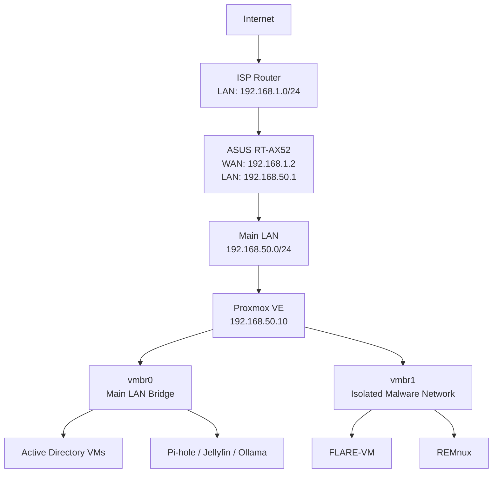

# Homelab Architecture

## Overview

This repository documents my personal cybersecurity homelab built on Proxmox VE. The environment is designed for Active Directory security testing, malware analysis, reverse engineering, networking, and self-hosted services.

## Network Architecture

### Physical Network

| Component | Configuration |
|---|---|
| ISP Router LAN | `192.168.1.0/24` |
| ASUS RT-AX52 | Wireless Router Mode |
| ASUS WAN IP | `192.168.1.2` |
| ASUS LAN IP | `192.168.50.1` |
| Main LAN Subnet | `192.168.50.0/24` |
| Proxmox Host | `192.168.50.10` |

The ASUS router connects to the ISP router through its WAN port. It creates a separate LAN network for the homelab.

This setup uses double NAT:
1. ISP router performs the first NAT.
2. ASUS RT-AX52 performs the second NAT.

### Network Diagram

